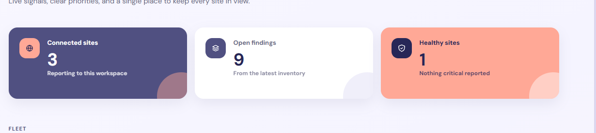
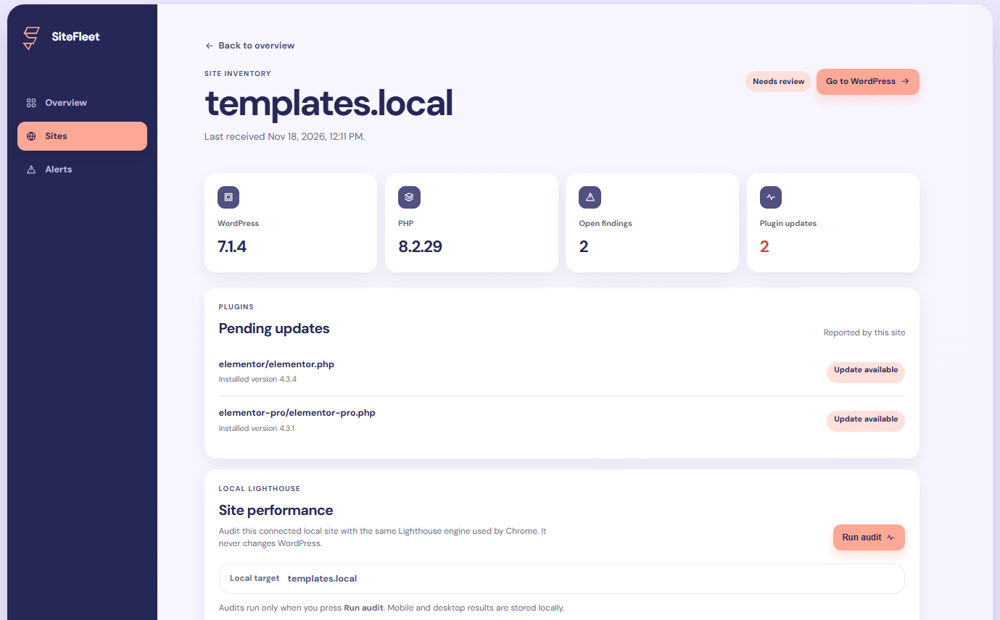
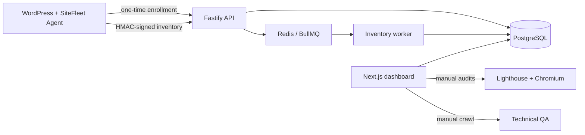

# SiteFleet

**Local-first fleet operations for WordPress sites.**

SiteFleet gives an agency one operational view of its WordPress installations: each site sends a signed inventory, the dashboard turns that inventory into actionable findings, and an operator can run focused performance and technical QA checks without exposing local development sites to the public internet.





## What it does

- Connects WordPress installations through a lightweight agent plugin.
- Records WordPress, PHP, plugin, theme, SSL, and update-state inventory.
- Evaluates inventory asynchronously and surfaces open findings per site.
- Lets an operator open the WordPress admin directly, then use **Update SiteFleet** in the WordPress toolbar to publish the new state.
- Runs manual local Lighthouse audits for mobile and desktop, including category scores, lab metrics, and high-impact opportunities.
- Runs manual crawl-based Technical QA for broken internal links, failed same-origin resources, missing image alt text, and basic on-page SEO structure.
- Keeps the operational UI deliberately focused: overview, site directory, alerts, and persistent site detail views.

## Architecture



The enrollment token is single-use. The agent subsequently signs every inventory with HMAC SHA-256, a timestamp, and an idempotency key. Agent secrets are encrypted with AES-256-GCM at rest; the encryption key belongs in environment configuration, never in PostgreSQL or Git.

See [the architecture notes](docs/architecture.md) for the operational boundaries and request flow.

## Technology

| Area | Implementation |
| --- | --- |
| Dashboard | Next.js 16, React 19, TypeScript |
| API | Fastify 5, TypeScript, Zod |
| Data | PostgreSQL 16 |
| Async evaluation | Redis 7, BullMQ |
| WordPress integration | Native PHP plugin and WordPress APIs |
| Performance checks | Lighthouse 12, Chrome Launcher |
| Local environment | Docker Compose |

## Repository layout

```text
apps/api/                 Fastify API, migrations, queue worker, and tests
apps/dashboard/           Next.js operations dashboard and local audit runners
wordpress-plugin/         SiteFleet Agent WordPress plugin
docs/                     Architecture, audit, security, and production notes
compose.yaml              Local stack: API, worker, Postgres, Redis, dashboard
```

## Run locally

### Prerequisites

- Node.js 22+
- Docker Desktop
- A local WordPress installation is optional, but required to connect a site and run audits

### Start the stack

```bash
npm install
Copy-Item .env.example .env
docker compose up --build
```

Open `http://localhost:3000` and sign in with the dashboard values from `.env`. The API health endpoint is available at `http://localhost:3001/health`.

The supplied `.env.example` is intentionally for local development only. Replace every value before any shared or production deployment.

### Connect a local WordPress site

1. Copy `wordpress-plugin/sitefleet-agent.php` into `wp-content/plugins/sitefleet-agent/` and activate it.
2. Create a one-time enrollment token:

   ```bash
   npm run registration-token --workspace=@sitefleet/api -- --expires-hours=72
   ```

3. In WordPress, open **Tools → SiteFleet Agent** and enter the token with the API URL.
   - Native WordPress on the host: `http://localhost:3001`
   - WordPress running in Docker: `http://host.docker.internal:3001`
4. After WordPress, PHP, or plugin updates, use **Update SiteFleet** from the WordPress admin toolbar to send a fresh inventory.

The agent does not install updates, store WordPress administrator credentials, or initiate automatic logins.

## Local performance and Technical QA

Both checks are intentionally operator-triggered and run against the connected site's reported URL.

- **Lighthouse:** Mobile and Desktop category scores, lab metrics, and opportunities. [Audit guide](docs/manual-lighthouse-audits.md)
- **Technical QA:** Same-origin crawl for objective failures and document structure issues. [QA scope](docs/technical-qa.md)

The local Docker dashboard maps `*.local` to the host machine by default. This keeps a local WordPress environment private while allowing Chromium in the dashboard container to audit it.

## Security model

- Single-use enrollment tokens; the database stores only their hashes.
- Per-agent HMAC signatures over method, route, timestamp, and request body.
- Five-minute replay window and idempotency keys for inventory delivery.
- AES-256-GCM encryption of stored agent secrets.
- No credentials, enrollment tokens, or encryption keys are committed to the repository.

Read the [threat model](docs/threat-model.md) and [production onboarding guide](docs/production-onboarding.md) before connecting a public site.

## Verification

```bash
npm test
npm run typecheck
npm run build
npm run build:dashboard
```

## Production path

This repository ships a local-first operating model. A production deployment should place the API behind HTTPS, keep PostgreSQL and Redis private, add rate limiting and monitored backups, and provide a managed remote audit runner where needed. The signed inventory protocol and WordPress agent remain the same. The [production guide](docs/production-onboarding.md) describes the required baseline.

## License

SiteFleet is source-available under the [PolyForm Noncommercial 1.0.0](LICENSE) license. You may inspect, study, experiment with, and redistribute the code for noncommercial purposes, provided you retain the license and required notice.

Commercial use—including operating SiteFleet for an agency, client, paid service, or internal commercial workflow—requires a separate written license from the copyright holder. Contact the repository owner to discuss commercial licensing.

`Required Notice: Copyright (c) 2026 Carlos Menco. SiteFleet.`
